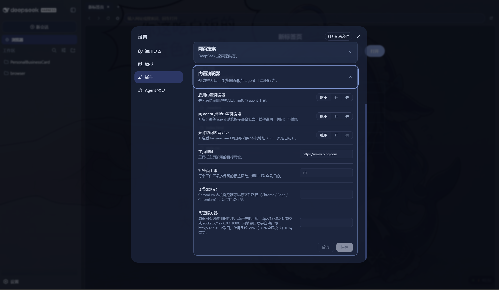
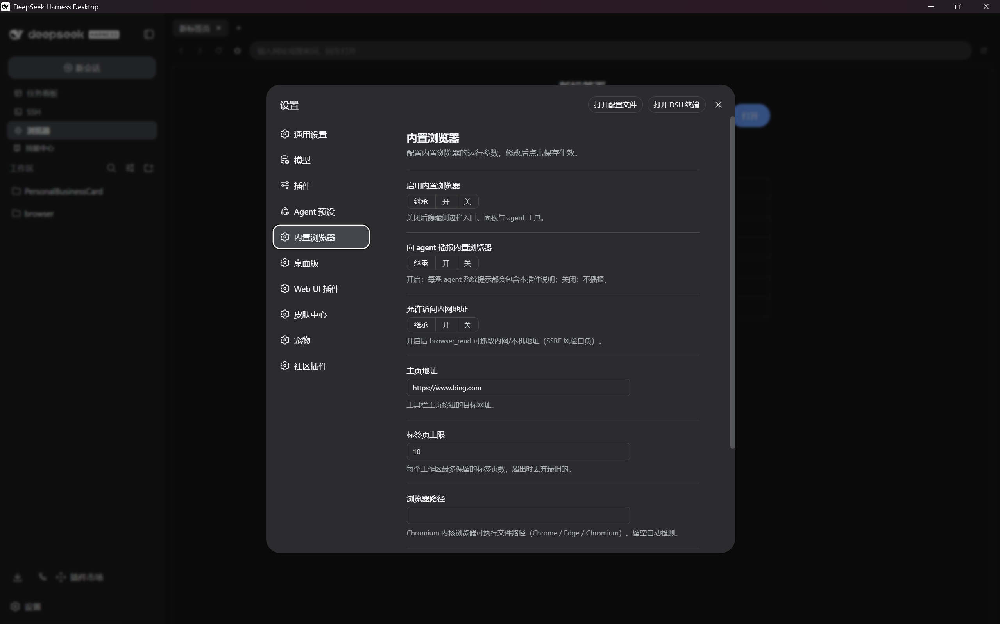

# DSH 内置浏览器

[English](README.md) | 中文

> DSH Web GUI 的内置浏览器：在聊天界面里浏览网页与工作区文件——多标签、地址栏、
> 标签页按工作区持久化、页面区域批注与轻量工作区编辑器——并提供 agent 工具
> （`browser_open`、`browser_read`、`browser_review`）。
> 页面由宿主端的无头 Chromium（Puppeteer）渲染，因此发送 `X-Frame-Options`
> 的站点也能正常加载。

DeepSeek Harness（DSH）的外部插件包，单包双半区 cordis bundle：host 半区拥有
agent 工具、`/api/dsh-browser` 路由族（Puppeteer 页面代理 + SSE 打开事件流 +
工作区文件列表/读取/编辑 + 批注存储）、设置命名空间与系统提示词公告；browser 半区渲染侧边栏
入口、多标签面板与插件设置卡。热插拔挂载——
`dsh plugin --profile <name> add link:<repo>`。

> **平台支持**：同时兼容 DSH Web 版与 Desktop 版（需 DSH v0.1.1-rc.1 及以上）。
> 可视化设置卡在两端均开箱即用，无需改动 DSH 源码。Web 版位于「设置 → 插件」，
> Desktop 版为左侧导航栏独立菜单项「内置浏览器」。

## 前置要求

宿主机器必须安装基于 Chromium 的浏览器（Chrome、Edge 或 Chromium）。插件在
Windows、macOS、Linux 上自动检测可执行文件路径，也可在设置卡中手动指定。
插件使用 `puppeteer-core`（而非 `puppeteer`），不会自行下载 Chromium。

## 功能

- **入口**：侧边栏「浏览器」一行，位于新建会话按钮下方。
- **更新提示**：「浏览器」旁的独立按钮在发现安装来源可用的新版本后显示「可更新」。
  点击可查看当前版本、更新说明、手动检查、更新指引及忽略/恢复提醒，不会导航
  或重载预览页面。这里只提示，不会自动安装包、修改文件或重启 Host。
- **面板**：接管中心列，包含标签栏、工具栏（后退 / 前进 / 刷新 / 主页 /
  在系统浏览器中打开）、地址栏（网址或搜索词，回车打开）与 iframe 内容区。
  每个页面由宿主端共享的无头 Chromium 渲染——代理路由等待 `networkidle`，
  读取完整执行后的 DOM，注入 `<base>` 与链接拦截脚本，再返回给 iframe。
  非活动标签保持挂载、状态不丢；iframe 首次激活时才加载，避免恢复大量标签
  时一次性发请求。
- **链接拦截**：代理页面内的 `http(s)` 链接点击会被捕获并通知面板——
  `target="_blank"` / `window.open` 新开标签，普通链接在当前标签导航。
  任何情况都不会弹出系统浏览器。
- **按工作区持久化**：标签集按项目根目录存入 localStorage（防抖写入 +
  页面隐藏时冲刷）。切换会话即切换整个标签集，切回自动恢复。可配置上限
  （默认 10），超出丢弃最旧的未激活标签。
- **工作区浏览**：新标签页列出当前工作区目录（文件夹可进入、面包屑导航、
  上一级按钮）；点击文件经宿主文件路由在面板中打开。HTML 预览注入 `<base>`
  使相对图片/样式可解析，并以 CSP `sandbox` 头保证被预览文件绝不能在 GUI
  源中执行脚本。
- **前端区域批注**：在工作区 HTML 预览中开启「批注」时，浏览器会在已经挂载的
  iframe 内启用受能力令牌约束的桥接脚本。进入选点既不会导航或重新加载页面，
  也不会为选点截图，因此当前组件状态、动画与滚动位置会继续保留。点击任意可见
  位置即可选中对应 DOM 元素，编号标记和评论框显示在浏览器外层，并在页面顶层
  滚动时继续对齐。代理打开的开发服务器页面采用兼容的外层选点方式：可用时先
  冻结截图并支持拖拽框选更大区域，截图不可用时降级为实时坐标层。连续添加一条
  或多条意见后，由用户明确确认，再一次性交给当前 Agent。交付前，误加的草稿
  评论可经二次确认后删除；已经交给 Agent 的评论会保留在批注历史中。每条批注
  包含可信的用户文字，以及不可信的页面 URL、选择器、附近文字/HTML、视口矩形、
  文档尺寸和选点时滚动位置。交付时，Host 会尽力为每个被批注页面截取一张图片，
  作为 Agent 的可选上下文；截图失败不会阻止评论交付。批注仅在当前 DSH host
  生命周期内存储；若 Agent 消息或图片附件未能入队，批次会恢复成草稿，用户可重试。
- **轻量工作区编辑器**：「编辑器」抽屉可浏览已注册工作区，并用 CodeMirror
  打开文本文件，支持常见前端格式的语法解析；常见 PNG/JPEG/GIF/WebP/AVIF/
  SVG/BMP/ICO 图片以只读、自适应方式预览。文本保存时校验内容哈希，发现文件已
  被其他操作修改便拒绝覆盖。完整 VS Code 体验留待后续版本。
- **agent 工具**：`browser_open` 把网页推送到面板（新开标签并聚焦面板）；
  `browser_read` 由宿主抓取网页并返回可读正文文本（静态 HTML 近似提取，
  不执行 JS）；`browser_review` 读取用户已确认的批注批次及页面区域坐标，
  `browser_review_resolve` 将完成的批注标记为已解决。
- **设置卡**：Web 版在「设置 → 插件」区新增「内置浏览器」卡片；Desktop 版
  在左侧导航栏新增「内置浏览器」独立设置页。两者均支持暂存编辑、保存/放弃、
  继承/恢复默认语义。字段：启用开关、agent 播报、主页地址、标签上限、内网访问
  开关、浏览器可执行文件路径、代理服务器、自动检查更新及可选的仓库跟踪。
- **agent 公告**：系统提示词段落向每个 agent 说明本插件、工具与限制（与
  dsh-ssh 同一机制）。

## 安装

```sh
# 本地 checkout（开发模式）
dsh plugin --profile <name> add link:<repo>

# npm（已发布）
dsh plugin --profile <name> add @nono-neko/dsh-browser
```

重启 `dsh web` 后侧边栏出现入口。web profile 需具备 bundle 注入的
`@deepseek-ai/*` 客户端包（任何 rc.6 web 部署都自带）。请确保宿主机器已安装
基于 Chromium 的浏览器。

## 卸载

```sh
# 从指定 profile 移除
dsh plugin --profile <name> remove @nono-neko/dsh-browser

# 如果是本地 checkout 安装
dsh plugin --profile <name> remove link:<repo>
```

移除后重启 `dsh web`。

## 配置

插件设置采用分层解析：schema 默认值 → 插件 `cordis.yml` 入口配置（组合基
层）→ 用户设置文档。所有字段均可选。

| 字段 | 类型 | 默认值 | 说明 |
|---|---|---|---|
| `enabled` | boolean | `true` | 挂载侧边栏入口、工具与代理路由。 |
| `announceToAgent` | boolean | `true` | 注入 system-prompt 段落，告知 agent 浏览器与批注工具的存在。 |
| `autoCheckUpdates` | boolean | `true` | 启动时及每六小时检查插件的公开版本。 |
| `followRepositoryUpdates` | boolean | `false` | 仅源码安装生效：按构建时提交与仓库默认分支比较，而非只检查正式 Release。 |
| `defaultHome` | string | `https://www.bing.com` | 新标签页 / 主页按钮加载的 URL。 |
| `maxTabs` | number | `10` | 每个工作区的标签上限，超出后裁剪最久未激活的标签。 |
| `allowPrivateAccess` | boolean | `false` | 允许 `browser_read` 访问内网 / loopback 地址。 |
| `browserExecutable` | string | 自动检测 | Chromium 系浏览器（Chrome / Edge / Chromium）的绝对路径。 |
| `proxyServer` | string | 空 | 通过代理路由 Puppeteer 流量，例如 `http://127.0.0.1:7890`。 |

### 可视化设置卡

插件开箱即用地提供可交互的设置表单（需 DSH v0.1.1-rc.1 及以上）：

- **Web 版**：**设置 → 插件 → 内置浏览器**
- **Desktop 版**：左侧导航栏 **内置浏览器** 独立设置页

| Web 版设置卡 | Desktop 版设置页 |
|---|---|
|  |  |

### 配置文件方式（不使用可视化设置卡）

如果不想使用可视化设置卡，可以直接通过文件配置相同字段。有两个层级：

**插件入口配置**（`cordis.yml` 或 profile 的插件配置）——组合基层，对该
profile 的所有用户生效：

```yaml
plugins:
  dsh-browser:
    defaultHome: https://www.google.com
    maxTabs: 20
    proxyServer: http://127.0.0.1:7890
```

**用户设置文档**（`~/.dsh/settings.yaml`）——用户级覆盖，叠加在入口配置之
上：

```yaml
dsh-browser:
  browserExecutable: C:\Program Files\Google\Chrome\Application\chrome.exe
  allowPrivateAccess: true
```

### 更新提示行为

- Host 检查 npm 上的 `@nono-neko/dsh-browser` 和 GitHub 上
  `Nono-neko/dsh-browser` 的正式 Release。npm 安装跟随 `latest` 标签中的
  正式版本；源码安装跟随 GitHub Release。只在 GitHub 发布的版本不会被当作
  npm 可安装更新。预发布、同版本和降级不触发提醒。无法识别安装方式时会明确
  标注，并可展示任一来源的新版本；请先核对原有安装方式再更新。
- 当前运行版本在构建时由本插件包信息写入，不读取当前工作区的版本。插件包根
  目录带 `.git` 时识别为源码安装；位于 `node_modules` 时识别为 npm 安装，
  其他布局标记为未知。可选的默认分支跟踪把干净构建时的提交与远端顶端比较，
  只在远端领先时提示。未提交/监听模式构建、缺少提交信息、尚未公开的本地提交
  或分叉历史无法可靠比较，请到仓库核对。源码更新后需重新构建、重启 Host，
  再刷新 GUI。
- 结果与 ETag 缓存在 Host 内存，并发请求会合并；手动检查最多每分钟一次，
  自动检查在上次检查完成六小时后运行。关闭自动检查后仍可手动检查；禁用插件
  或卸载其运行实例会停止后台检查。GUI 只轮询本地缓存，不直接请求 GitHub/npm。
  断网、限流等错误显示为不可用，不会显示为「未发现新版本」。
- 忽略版本只隐藏该版本的侧边栏提醒，详情仍可查看并恢复提醒。选择按 GUI
  来源保存在 localStorage 中；存储不可用时退化为内存。后续新版本仍会提示。
  检测设置与结果属于整个插件，不按工作区区分。
- 检测使用 Host 的网络连接，不使用 Puppeteer 的 `proxyServer` 配置。
  手动更新前请保存编辑器内容与本地修改。更新按钮不提供自动升级、Git 操作
  或重启能力。

## 常见问题

**Q：安装时报 `ERR_PNPM_GIT_DEP_PREPARE_NOT_ALLOWED` 怎么办？**

A：这是通过 git 安装时 pnpm 默认阻止了 `prepare` 构建脚本。推荐改用 npm
安装（已预构建，无需编译）：

```sh
dsh plugin --profile <name> add @nono-neko/dsh-browser
```

如果坚持用 git 安装，在 profile 的 `pnpm-workspace.yaml` 中添加
`allowBuilds`：

```yaml
allowBuilds:
  - '@nono-neko/dsh-browser'
```

## 开发

独立验证更新界面可运行 `pnpm exec vite --host 127.0.0.1`，再打开终端所示
本地地址下的 `/tests/fixtures/update-notifier.html`。测试页使用模拟更新响应
及实时动画 iframe，不访问注册表或修改 DSH。可验证提醒、忽略/恢复、失败状态、
深浅主题、弹窗键盘交互，以及预览滚动位置不变。

```sh
pnpm install    # @deepseek-ai/* SDK 包已在 npm 公开（或走镜像）
pnpm build      # tsc 出类型 + tsdown 产出双半区（lib/index.js + lib/client.js）
pnpm typecheck  # tsc --noEmit
pnpm test       # vitest
```

一份配置产出两个产物：node 半区 `lib/index.js`（esm）与 browser 半区
`lib/client.js`（`window.__ModuleLoader__` 闭包工厂，经
`/plugins/dsh-browser/client.js` 提供给 GUI）。CSS Modules 由 lightningcss
编译进 client bundle；client bundle 带纯度门——`@deepseek-ai/*` 的值导入仅
允许平台种子模块，其余必须内联或经 cordis 服务协作。

## 安全模型

- **Loopback 围栏**：所有 `/api/dsh-browser` 路由（代理、SSE、文件、批注截图、
  源码编辑、批注与更新元数据）拒绝非
  loopback 客户端（套接字地址 + Host 头 + 同源标记）。LAN 暴露的 dsh web
  无法向未配对设备提供工作区文件或代理服务。
- **工作区门禁**：文件列表、读取、批注截图、批注存储与源码编辑先对请求根做 realpath 规范化并要求其为已
  注册工作区（或位于其内）；每个请求路径解析后再次校验，符号链接无法逃逸。
- **更新元数据边界**：`GET /api/dsh-browser/updates` 读取缓存状态；
  `POST /api/dsh-browser/updates/check` 发起受频率限制的检查。两者均遵守
  loopback 围栏，但不需要工作区，因为不会读取项目文件。出站请求只访问
  `registry.npmjs.org` 与 `api.github.com` 上的固定 HTTPS 接口，拒绝重定向，
  每次响应限时 10 秒、限大小 512 KiB。不发送工作区路径、源码内容、凭据或
  评论。User-Agent 携带插件版本；可选仓库跟踪还会发送本插件构建时的提交以供
  比较。更新说明只作为不可信纯文本展示，不执行 HTML，也不作为 Agent 指令；
  链接由固定仓库/包地址构造，不采信远端返回的链接。
- **预览 HTML 沙箱**：工作区预览 HTML 以 `Content-Security-Policy: sandbox`
  和不透明 iframe 来源运行。host 为页面已有脚本统一添加本次响应的随机 nonce，
  使本地样式与交互可用，但不给页面访问 GUI API 的权限。不透明
  来源的资源 GET 必须同时具备浏览器判定的子资源类型，以及由首次同源文档加载
  登记的短时随机能力令牌；脚本 `fetch()` 与所有写接口继续受普通同源围栏保护。
  同一能力令牌也用于限定实时批注桥接；父页面只接受来自当前活动 iframe 且令牌
  匹配的消息，并把桥接上报的选择器、属性与矩形全部视为不可信页面上下文。
- **代理页面使用不透明来源 iframe 沙箱**：Puppeteer 渲染的 HTML 响应不带
  CSP / X-Frame-Options，面板 iframe 允许脚本和表单，但刻意不授予
  `allow-same-origin`。页面脚本因而无法读取父 GUI 或调用其 loopback API。
  这些代理页面的点击选点、拖拽框选与编号标记完全位于浏览器外层，不需要读取
  frame 内的 DOM。
  页面 URL 与
  所有页面衍生上下文始终不可信，绝不视为 Agent 指令。
- **源码写入受保护**：编辑器只接受不超过 4 MB 的文本文件，真实路径必须位于
  已注册工作区内，符号链接/路径逃逸会被拒绝；保存前校验预期 SHA-256 哈希，
  并以原子替换方式写入。
- **browser_read 的 SSRF 防线**：请求发出前先经 DNS 解析目标主机名，每个
  地址都必须是公网地址（内网/回环/链路本地/保留段一律拒绝）。重定向逐跳
  手动跟随并复检，公网 URL 跳转到内网地址无法绕过。设置中的
  `allowPrivateAccess` 是显式豁免，风险自负。
- **代理路由使用 Puppeteer**：无头 Chromium 抓取页面，因此 `browser_read`
  的 SSRF 防线不适用于面板代理或批注截图。`proxyServer` 设置允许你通过本地
  VPN / 代理路由浏览流量；截图视口限制在 1920 × 1080 像素内。
- **大小与超时上限**：`browser_read` 响应体超过 2 MB 在读入前即报错；超过
  64 MB 的工作区文件拒绝提供；每次 Puppeteer 渲染 30 秒超时；编辑器源码
  文件上限为 4 MB。

## 限制

- **登录态不持久**：每个代理页面开启一个全新的 Puppeteer 页面，渲染后即关闭。
  Cookie 与登录状态不在请求间保留，因此需要登录的站点会显示未登录视图。
- **仅支持 GET**：面板代理支持 GET 请求。表单提交（POST）与文件上传不走
  代理——它们会在 iframe 内执行，可能被目标站点的 `X-Frame-Options` 拦截。
- **JS 渲染的导航**：初始页面由 Puppeteer 完整渲染，但后续页面内导航
  （SPA 路由、表单提交）在 iframe 内发生，新 URL 可能命中 `X-Frame-Options`。
  普通 `<a>` 链接会被拦截并重新走代理。
- **`browser_read` 只能看到静态 HTML**：JS 渲染的页面拿不到客户端渲染内容，
  也无法使用你的登录态。
- **实时 DOM 选点仅支持工作区 HTML**：代理打开的开发服务器页面仍使用截图/
  坐标选点，因此其瞬时动画状态可能与稍后附加的截图不完全一致。
- **工作区交付截图来自一次新的无头渲染**：它不会重新加载或移动用户正在看的
  iframe，但附件中的瞬时动画与滚动状态可能不同于用户点击时的实时页面；结构化
  选择器、点击坐标和选点时滚动位置才是定位依据。
- **批注尚未持久化**：DSH host 重启后，评论和批次会被清空。
- **浏览会在宿主机器上消耗真实网络流量。**

## 许可证

Apache-2.0
